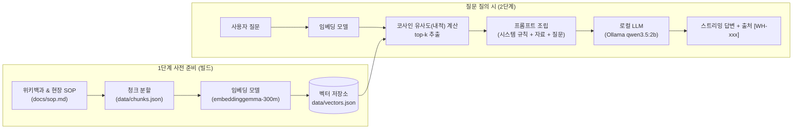

# 물류창고 재고 조사 안내 챗봇 (내 PC에서 끝나는 RAG 2단계)

> **1단계 (RAG 기초)**: 문서를 수집하여 768차원 벡터로 변환·저장하고, 질문과 코사인 유사도가 가장 높은 문서를 검색합니다.  
> **2단계 (프로젝트)**: 검색된 청크와 사용자 질문을 프롬프트로 조립하여 로컬 LLM(Ollama `qwen3.5:2b`)에 전달하고, 근거에 기반한 스트리밍 답변 및 출처를 제공합니다.  
> **환경**: 외부 서버·API 호출 없이 순수 로컬 환경(Windows PowerShell + Node.js)에서 동작합니다.

---

## 1. 소개

- **목적**: 물류창고에 새로 배치된 신규 작업자가 현장 표준 작업 절차(SOP) 및 재고 관리 전문 용어를 쉽게 학습하고 조회할 수 있도록 지원하는 CLI 챗봇입니다.
- **답할 수 있는 내용**: 
  - 재고 실사 절차, 순환재고조사 방법, 실사 차이 발생 시 처리 단계, 현장 안전 수칙
  - ABC 분석, 선입선출(FIFO), WMS(창고관리시스템), RFID/바코드 기술 등 물류 기본 개념
- **답할 수 없는 내용 (비목표)**:
  - 현재 시점의 특정 품목·로케이션별 실시간 재고 수량 (해당 업무는 사내 WMS 및 ERP 시스템에서 직접 조회해야 함)
  - 웹 UI, 서버 배포, 사용자 로그인 기능

---

## 2. 동작 원리



### 5줄 요약
1. 창고 SOP와 위키백과 문서를 사실 단위(120자 이상)의 청크 13개로 나누어 `data/chunks.json`에 보관합니다.
2. `embeddinggemma-300m-ONNX` 모델로 각 청크를 768차원 정규화 벡터로 변환하여 `data/vectors.json`에 저장합니다.
3. 사용자가 질문하면 질문 벡터를 생성하고 청크 벡터들과 내적(코사인 유사도)을 계산하여 상위 $k$개 문서를 검색합니다.
4. 검색 유사도가 기준점(`0.55`) 미만일 경우 약한 근거 경고를 부착하고, 역할과 근거 원칙이 포함된 프롬프트를 조립합니다.
5. 로컬 Ollama(`qwen3.5:2b`)에 프롬프트를 전달하여 환각 없이 검증된 자료에 근거한 실시간 스트리밍 답변과 출처 목록을 출력합니다.

---

## 3. 사용 기술 및 사양

| 구분 | 도구 / 모델 | 세부 설정 및 역할 |
|---|---|---|
| **런타임** | Node.js (v20+) | ES 모듈 (`type: module`), 표준 라이브러리 기반 CLI |
| **임베딩 라이브러리** | `@huggingface/transformers` | JavaScript 환경에서 ONNX 임베딩 모델 직접 구동 |
| **임베딩 모델** | `onnx-community/embeddinggemma-300m-ONNX` | `dtype: "q8"` (약 300MB), 768차원, Mean Pooling, L2 정규화 |
| **임베딩 프롬프트 형식** | EmbeddingGemma 공식 접두어 | 문서: `title: {section} \| text: {text}`<br/>질문: `task: search result \| query: {question}` |
| **유사도 기준** | 코사인 유사도 (내적) | 정규화 벡터의 내적 계산, `WEAK_THRESHOLD = 0.55` |
| **LLM 런타임** | Ollama (로컬) | `http://localhost:11434`, `temperature: 0`, 스트리밍(NDJSON) |
| **생성 모델** | `qwen3.5:2b` | 경량 2B 언어 모델, 파라미터 Q8 양자화 |

---

## 4. 실행 방법

### 4-1. 사전 준비
Ollama 실행 및 모델 내려받기:
```powershell
ollama pull qwen3.5:2b
```

의존성 패키지 설치:
```powershell
npm install
```

### 4-2. 1단계: 벡터 인덱스 빌드
```powershell
node src/build-index.mjs
```
- `data/chunks.json`을 검사하고 임베딩을 수행하여 `data/vectors.json`을 생성합니다. (최초 실행 시 임베딩 모델 약 300MB 다운로드)

### 4-3. 1단계: 유사도 검색 실행
```powershell
# 단일 또는 복수 질문 검색 (기본 top-3)
node src/search.mjs "재고 실사 차이가 나면 어떻게 처리해?" "ABC 분석이 뭐야?" "내일 날씨 어때?"

# 검색 결과 개수 변경
node src/search.mjs "ABC 분석이 뭐야?" --k 5
```

### 4-4. 2단계: RAG 답변 실행
```powershell
# 기본 RAG 질의응답 (검색 -> 프롬프트 조립 -> LLM 스트리밍 -> 출처 검증)
node src/ask.mjs "재고 실사 차이가 나면 어떻게 처리해?"

# 프롬프트 조립 결과만 확인 (Ollama 호출 없음)
node src/ask.mjs "재고 실사 차이가 나면 어떻게 처리해?" --show-prompt

# RAG 없이 LLM 순수 답변 비교
node src/ask.mjs "A등급 품목은 얼마나 자주 세?" --no-rag

# 대화형 CLI 모드 (모델을 메모리에 유지한 채 연속 질의)
node src/ask.mjs
```

---

## 5. 자료 및 청크 설계

### 5-1. 청크 설계 3대 원칙
1. **사실 하나(단일 주제)**: 하나의 청크에 상이한 주제를 섞지 않아 특정 질문에 무관한 청크가 오검색되는 것을 방지합니다.
2. **단독 완결성 (최소 120자 이상)**: 앞선 문맥이나 대명사("그것은") 없이 청크 단독으로 의미가 명확해야 합니다.
3. **원문 충실성 및 출처 보관**: 원문에 없는 해석이나 주관적 요약을 보태지 않으며, 모든 청크에 명확한 URL과 섹션명을 부여합니다.

### 5-2. 청크 목록 (총 13개)
| ID | 섹션명 | 출처 URL | 핵심 내용 |
|---|---|---|---|
| `WH-001` | 재고의 정의 | `https://ko.wikipedia.org/wiki/재고` | 원자재, 재공품, 완제품 등 보유 자산의 개념과 적정 수준 유지 필요성 |
| `WH-002` | 재고관리의 목적 | `https://ko.wikipedia.org/wiki/재고관리` | 고객 서비스 만족, 품절 방지 및 재고 유지 비용 최소화 |
| `WH-003` | 창고관리시스템의 역할 | `https://ko.wikipedia.org/wiki/창고관리시스템` | WMS를 통한 입출고·적치·피킹 통제 및 바코드/RFID 위치 추적 |
| `WH-004` | 재고수량 결정 | `https://ko.wikipedia.org/wiki/재고관리` | 안전재고(예비량) 설정 및 경제적 주문량(EOQ) 모형 |
| `WH-005` | 선입선출법 | `https://ko.wikipedia.org/wiki/선입선출법` | 먼저 입고된 상품을 먼저 출고하는 FIFO 원칙 및 랙 배치 |
| `WH-006` | 재고자산의 분류 | `https://ko.wikipedia.org/wiki/재고자산` | 상품, 완제품, 원재료 분류 및 저가법 평가 기준 |
| `WH-007` | ABC 분석 | `https://ko.wikipedia.org/wiki/ABC_분석` | 가치 비중(파레토 법칙)에 따른 A/B/C 등급별 중점 관리 기법 |
| `WH-008` | RFID와 바코드 | `https://ko.wikipedia.org/wiki/RFID` | 비접촉 다중 전파 인식을 통한 대량 스캔과 바코드 비교 |
| `WH-009` | 로케이션 관리 | `https://ko.wikipedia.org/wiki/창고관리시스템` | 고정/프리 로케이션 주소 부여 및 피킹 동선 최적화 |
| `WH-010` | 재고 실사의 기본 원칙 | `https://ko.wikipedia.org/wiki/재고관리` | 장부와 실물 수량 대조, 불일치 발견 및 장기체화 재고 선별 |
| `WH-011` | 순환재고조사 | `docs/sop.md#순환재고조사` | 구역 분할 조사, 블라인드 카운트, 등급별 주기(A:월1회, B:분기1회, C:반기1회) |
| `WH-012` | 실사 차이 처리 | `docs/sop.md#실사-차이-처리` | 담당자 변경 재실사, 원인 규명 순서, 5대 원인 분류, 관리자 승인 후 반영 |
| `WH-013` | 안전 수칙 | `docs/sop.md#안전-수칙` | 상단 랙 사다리 고정, 지게차 통로 형광조끼 착용, 파손 팔레트 발견 조치 |

---

## 6. 1단계 관찰 실습 기록

실제 `node src/search.mjs` 실행 결과로 측정된 1위 청크 및 유사도 점수입니다:

| # | 질문 | 유형 | 1위 청크 | 점수 | 관찰 포인트 |
|---|---|---|---|---|---|
| 1 | 재고 실사 차이가 나면 어떻게 처리해? | 정상 | WH-012 실사 차이 처리 | 0.790 | SOP의 핵심 처리 지침을 높은 점수로 정확히 매칭 |
| 2 | 실사 수량이 장부랑 안 맞으면? | 다른 표현 | WH-012 실사 차이 처리 | 0.699 | "차이", "처리"라는 단어가 없어도 의미적 유사성을 통해 정확히 검색 |
| 3 | ABC 분석이 뭐야? | 정상 | WH-007 ABC 분석 | 0.720 | 용어 정의를 정확히 1위로 도출 |
| 4 | RFID랑 바코드 차이 | 정상 | WH-008 RFID와 바코드 | 0.791 | 두 기술의 차이점을 다룬 청크를 명확히 포착 |
| 5 | 안전재고는 어떻게 계산해? | 경계 | WH-004 재고수량 결정 | 0.684 | "안전재고" 관련 예비량/발주 모형 청크를 1위로 도출 |
| 6 | A등급 품목은 얼마나 자주 세? | 복합 | WH-011 순환재고조사 | 0.656 | 1위 순환재고조사(0.656)와 2위 ABC 분석(0.652)이 나란히 상위에 올라옴 |
| 7 | 우리 창고 지금 A-01 재고 몇 개야? | 도메인 밖 | WH-001 재고의 정의 | 0.550 | 0.55 기준점에 걸쳐 ⚠가 뜨지 않음 ("재고"라는 공통 단어 영향) |
| 8 | 내일 날씨 어때? | 무관 | WH-004 재고수량 결정 | 0.427 | ⚠ 0.55 미만으로 떨어져 "관련 자료가 약함" 경고 정확히 발생 |
| 9 | 김치찌개 레시피 알려줘 | 무관 | WH-011 순환재고조사 | 0.375 | ⚠ 0.37대로 매우 낮게 측정되어 경고 발생 |

### 🧠 생각해 볼 것 (관찰 분석)
1. **단어가 겹치지 않아도 검색되는 이유**: 
   임베딩 모델은 글자(키워드) 매칭이 아니라 다차원 의미 공간의 벡터 좌표를 비교합니다. "장부랑 안 맞으면"과 "실사 차이"는 유사한 의미 벡터 방향을 가지므로 높은 유사도(0.699)가 산출됩니다.
2. **무관한 질문에도 1위가 나오는 이유**: 
   벡터 검색은 "정답이 존재하는지"를 판단하는 것이 아니라 보유한 벡터 중 "가장 가까운 상대적 벡터"를 무조건 정렬합니다. 따라서 0.55와 같은 절대적 기준선(Threshold)을 두어 무관한 질문을 판별해야 합니다.
3. **실시간 수량 질문(7번)에서 검색의 한계와 LLM의 필요성**: 
   "우리 창고 지금 A-01 재고 몇 개야?"는 "재고"라는 단어의 유사도로 인해 0.550 점수를 기록하여 검색 필터를 통과합니다. 검색 점수만으로는 "이 질문의 답은 현재 데이터베이스(WMS)를 실시간 조회해야 하며 본 정적 SOP 문서에는 없다"는 논리적 판단을 내릴 수 없습니다. 바로 이 점 때문에 2단계에서 LLM의 프롬프트 규칙(시스템 메시지)을 통해 "실시간 수량은 WMS에서 확인하라"고 제어해야 합니다.

---

## 7. 2단계 비교 실험 기록

동일한 질문에 대해 RAG 없이 질의했을 때와 RAG를 적용했을 때의 실측 비교입니다:

| 질문 | RAG 없이 (`--no-rag`) | RAG 적용 (기본) | [WH-xxx] 표시 여부 | 관찰 결과 및 내 판단 |
|---|---|---|---|---|
| **A등급 품목은 얼마나 자주 세?** | "상점 정책, 농산물 사과·배의 계절성, 주말 및 명절 판매량" 등 물류창고 실사와 상관없는 장황한 횡설수설 (88.3초 소요) | `[A] A 등급 품목은 월 1 회 조사 원칙으로 한다.` (21.1초 소요) | 본문에는 `[A]`로 축약, 📚 근거 1위로 `WH-011` 제시 | RAG 적용 시 답변 시간이 1/4로 줄고, SOP 규정인 "월 1회"를 정확히 짚어내 환각이 완전히 제거됨. |
| **우리 창고 지금 A-01 재고 몇 개야?** | "실시간 재고 데이터를 조회할 수 없으므로 ERP/WMS 시스템에 문의하라"고 거절 안내 (19.2초) | `[WH-007] ABC 분석은 ... 제가 가진 자료에는 없습니다` (31.9초) | `[WH-007]` 표시됨, ✓ 체크 완료 | RAG 적용 시에도 수량을 거짓으로 지어내지 않고 자료 부재를 명확히 시인함. |
| **내일 날씨 어때?** | (해당 일반 지식 답변 시도) | 1위 유사도 0.427 < 0.55 감지 후 `제가 가진 자료에는 없습니다` 단호하게 거절 (19.1초) | 자료 없음 안내 | ⚠ 약한 근거 경고가 발동하여 프롬프트의 보수적 원칙에 따라 정확하게 답변 거부. |

---

## 8. 한계와 다음 단계

### 8-1. 경량 2B 로컬 LLM의 한계
- **출처 ID 표기 누락**: 프롬프트에 `[WH-012]` 형식을 엄격히 요구했음에도, 작은 모델 특성상 `[A]`처럼 알파벳 하나만 붙이거나 ID 표기를 생략하는 경우가 발생합니다. (이를 보완하기 위해 CLI 프로그램 차원에서 📚 근거 목록을 별도로 검증·출력하도록 설계함)
- **추론 속도**: CPU 전용 환경에서 2B 모델의 토큰 생성에 20~30초가 소요됩니다. 스트리밍(NDJSON) 출력을 통해 체감 대기 시간을 개선했습니다.

### 8-2. 개선 방향
1. **하이브리드 검색 도입**: 제품 고유 번호(SKU)나 특정 로케이션 코드(A-01, B-03)처럼 철자가 정확해야 하는 단어는 BM25 키워드 검색을 벡터 검색과 결합하는 상호 순위 결합(RRF) 방식 적용 필요.
2. **실시간 WMS API 도구 연동 (Function Calling / Tool Use)**: 질문이 정적 절차가 아닌 "현재 수량"을 묻는 경우, 챗봇이 WMS 데이터베이스를 직접 조회하는 함수를 호출하여 실제 재고를 반환하도록 발전시킬 수 있습니다.
